<p align="center">
  
</p>

<p align="center">
  
</p>

## 🧑‍💻 Qui suis-je ?

```c
#include "life.h"

int main(void)
{
    profile_t nolan = {
        .ecole     = "Epitech (PGE, 1re année)",
        .boulot    = "Dev web freelance @ Frontcraft",
        .langages  = {"C", "Python", "Swift", "JavaScript", "Luau"},
        .apprend   = "tout, tout le temps",
    };

    while (cafe_restant())
        construire(nolan, un_truc_qui_dechire());
    return 0;
}
```

## 🛠️ Ma stack

<p align="center">
  
</p>

## 🚀 Ce que je construis

| | Projet | En bref |
|:-:|---|---|
| 🎯 | **My Hunter** | Un jeu de tir en C avec la CSFML, codé à Epitech. |
| 📊 | **Epidash** | Mon tableau de bord Epitech (projets, crédits, planning) en Python, avec une app macOS en Swift. |
| 🌐 | **Frontcraft** | Des sites web pour des clients, de la maquette Figma à la mise en ligne. |
| 🧬 | **Steal a Mutant** | Un jeu Roblox écrit en Luau. |

## 📈 Mon activité

<p align="center">
  
</p>

<p align="center">
  <picture>
    <source media="(prefers-color-scheme: dark)" srcset="https://raw.githubusercontent.com/nolanmrtz/nolanmrtz/output/github-snake-dark.svg">
    
  </picture>
</p>

<p align="center">
  
</p>
