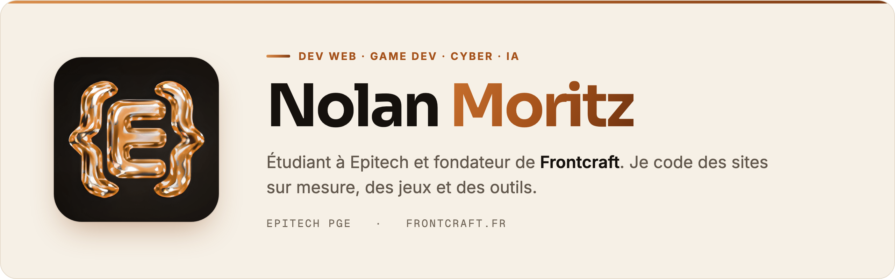
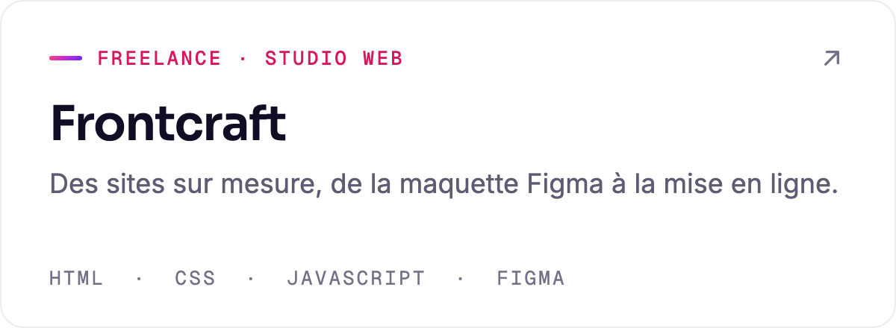
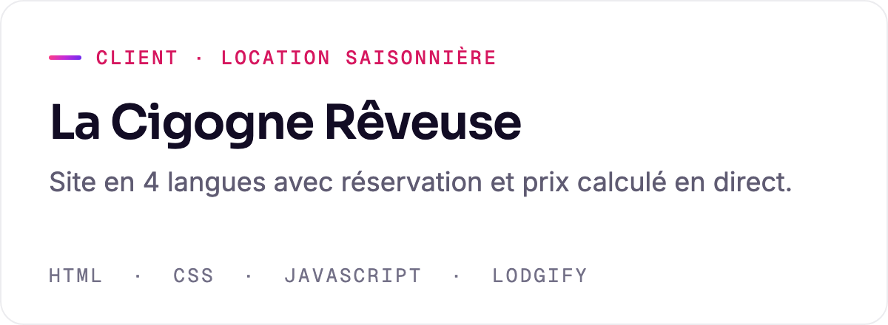
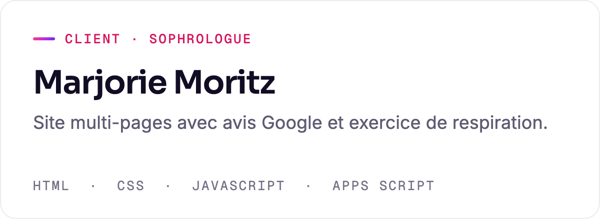
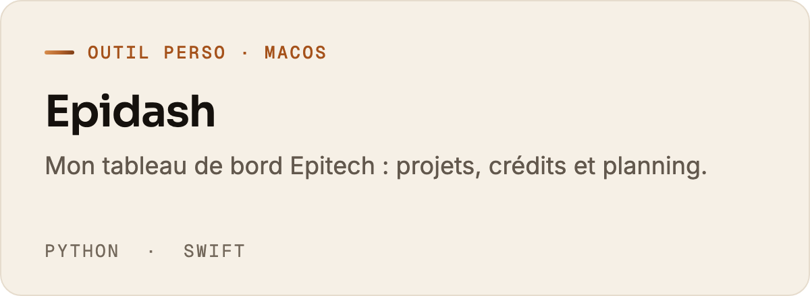
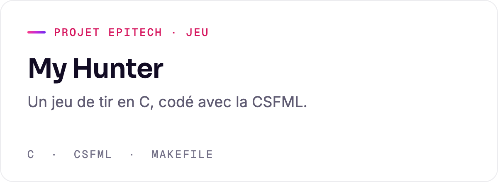
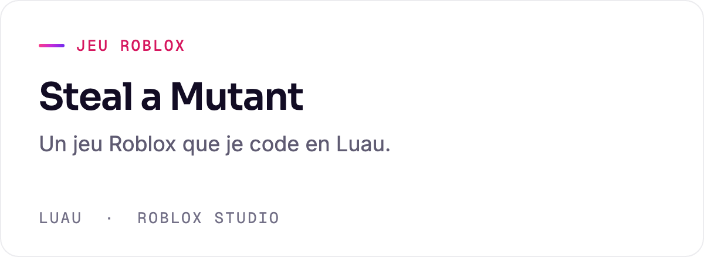

  <picture>
    <source media="(prefers-color-scheme: dark)" srcset="./assets/banner-dark.png"/>
    
  </picture>

 

Étudiant en **1re année à Epitech** (PGE) et **dev web freelance** avec [Frontcraft](https://www.frontcraft.fr). Je construis des sites, des jeux et des outils, et je me forme à la **cyber** et à l'**IA**.

#### Projets

<a href="https://www.frontcraft.fr"><picture><source media="(prefers-color-scheme: dark)" srcset="assets/card-frontcraft-dark.png"></picture></a>
<picture><source media="(prefers-color-scheme: dark)" srcset="assets/card-la-cigogne-reveuse-dark.png"></picture>

<picture><source media="(prefers-color-scheme: dark)" srcset="assets/card-marjorie-moritz-dark.png"></picture>
<picture><source media="(prefers-color-scheme: dark)" srcset="assets/card-epidash-dark.png"></picture>

<picture><source media="(prefers-color-scheme: dark)" srcset="assets/card-my-hunter-dark.png"></picture>
<picture><source media="(prefers-color-scheme: dark)" srcset="assets/card-steal-a-mutant-dark.png"></picture>

Le code des projets Epitech et des sites clients reste privé.

#### Stack

| Domaine | Ce que j'utilise |
|---|---|
| **Langages** | C · Python · JavaScript · Swift · Luau |
| **Web** | HTML · CSS · JavaScript · Figma |
| **Jeux** | CSFML · Roblox Studio |
| **Outils** | Git · GitHub · VS Code · Make · Linux · macOS |
| **En apprentissage** | Cybersécurité · IA |

#### Contact

**[nolan.moritz@epitech.eu](mailto:nolan.moritz@epitech.eu)** · [frontcraft.fr](https://www.frontcraft.fr)
